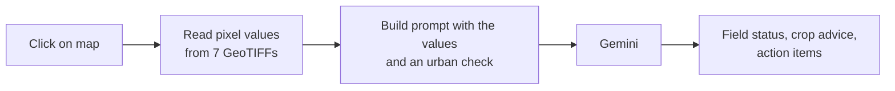

# Iowa Precision Agriculture WebGIS

**A web GIS for exploring crop, land cover, vegetation and climate layers across Iowa, with AI field insights grounded in the raster values at the point you click.**

Most "AI for agriculture" demos send a location to a language model and let it guess. This app does it the other way round: when you click a field, the app first reads the actual pixel values from seven local rasters (crop type, land cover, NDVI, rainfall, temperature, evapotranspiration, soil moisture) and only then asks Google Gemini to interpret them. The model's answer is therefore tied to measured data for that location.

## Features

- **Seven statewide layers** served as map tiles from local GeoTIFFs, each with its own legend and statistics
- **Point query**: click anywhere to read the value of every layer at that location
- **AI field insight**: the sampled values are passed to Gemini, which returns field status, crop recommendations and suggested actions
- **Urban and non-crop detection**: if the land cover or crop layer says the pixel is developed or urban, the prompt switches the model to a non-agricultural analysis instead of giving crop advice
- **Farm and field records**: a REST API (FastAPI + SQLAlchemy) for farms, fields, sensors, sensor readings and crop monitoring entries
- **Export**: save the AI insight for a location as a text report

## Datasets

| Layer | Source | What it shows |
|---|---|---|
| Cropland Data Layer | USDA NASS CDL 2023 | Crop type per pixel |
| Land Cover | NLCD 2021 | Land cover class |
| NDVI | Landsat | Vegetation vigour |
| Rainfall | GridMET | Gridded precipitation |
| Max Temperature | GridMET | Summer maximum temperature |
| Evapotranspiration | GridMET | Reference ET |
| Soil Moisture | NASA SMAP | Surface soil moisture |
| Boundary | Iowa state shapefile | Study area |

The rasters (about 500 MB) are **not included in the repository** because of their size. Put them in a `DATA/` folder in the project root, using the file names listed in [`local_data_api.py`](local_data_api.py) (for example `Iowa_CDL.tif`, `Iowa_Landsat_NDVI.tif`). See [IOWA_LOCAL_DATA_GUIDE.md](IOWA_LOCAL_DATA_GUIDE.md) for how they were prepared.

## How it works



## Tech stack

| Part | Technology |
|---|---|
| Backend | Python, FastAPI, SQLAlchemy (SQLite), Rasterio, GeoPandas, Shapely, Pydantic |
| Frontend | Vanilla JavaScript, Leaflet |
| AI | Google Gemini 2.0 Flash through its REST API |

## Run it locally

You need Python 3.10+, the `DATA/` folder described above, and a free Gemini API key from [Google AI Studio](https://aistudio.google.com/app/apikey).

```bash
git clone https://github.com/Gull01/Iowa-Precision-Agri-Web-App.git
cd Iowa-Precision-Agri-Web-App
python -m venv .venv
source .venv/bin/activate        # Windows: .venv\Scripts\activate
pip install -r requirements.txt
cp .env.example .env             # then set GEMINI_API_KEY
python main.py
```

Open http://localhost:8000/static/index.html. The map and layers work without a key; only the AI insight needs one.

## Project structure

```text
main.py              FastAPI app: farms, fields, sensors, monitoring and AI endpoints
local_data_api.py    Raster tiles, point values and statistics for the Iowa layers
gemini_ai.py         Prompt building and Gemini calls
models.py, schemas.py, database.py, config.py
static/              Map interface (Leaflet) and AI insight panel
```

Extra notes: [SETUP_INSTRUCTIONS.md](SETUP_INSTRUCTIONS.md), [SYSTEM_ARCHITECTURE.md](SYSTEM_ARCHITECTURE.md), [AI_INSIGHTS_GUIDE.md](AI_INSIGHTS_GUIDE.md), [SECURITY_GUIDE.md](SECURITY_GUIDE.md).

## Limitations

- The rasters are a single snapshot (for example CDL 2023 and NLCD 2021), not a live time series.
- AI recommendations are interpretations of the sampled values and should be checked by an agronomist before acting on them.

## Author

Gul Nawaz, GIS and remote sensing specialist. [gulnawaz.dev](https://gulnawaz.dev)

## License

MIT
